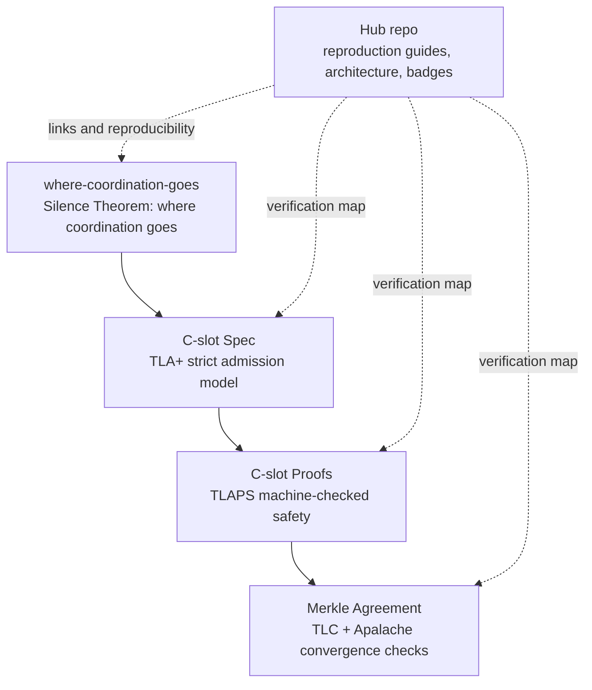

# 👋 Vasilis Nasopoulos — Vortex DSE


This profile is the public landing page for Vortex DSE research artifacts: the Silence Theorem, executable specifications, deductive proofs, agreement models, and demonstrations. The public repositories are related components and evidence slices, not a single publicly composed end-to-end proof of the private production engine.

[](https://github.com/vasilisnasopoulos/vasilisnasopoulos/actions/workflows/verify-proofs.yml)
[](https://github.com/vasilisnasopoulos/vasilisnasopoulos/actions/workflows/verify-tlc.yml)
[](https://github.com/vasilisnasopoulos/vasilisnasopoulos/actions/workflows/verify-apalache.yml)
[](LICENSE)
[](#-topics)
[](RELEASE_NOTES.md)

## 🚀 What is Vortex DSE?

**Vortex DSE** is a deterministic ordering and agreement research stack for distributed systems:

- Leaderless: consensus only where it is provably unavoidable — on silence — and exactly as much as needed
- Admission logic formalized in **TLA+**
- Safety obligations proved with **TLAPS**
- Bounded behavior validated with **TLC** and **Apalache**
- Reference scenarios provided for easier implementation alignment

> **Reviewer scope note:** The public artifacts establish different claims with different kinds of evidence; they are not a proof of the complete production engine. Start with the [claims, evidence, and scope matrix](CLAIMS_AND_SCOPE.md) and [public verification slices](SLICES.md).

## 💡 Why this matters

- **For researchers:** the repositories expose assumptions, invariants, and proof obligations in a form that can be inspected and reproduced.
- **For engineers:** they show how consensus and admission rules can be specified before implementation details become production bugs.
- **For new readers:** the stack is organized as a path from motivation ➜ executable model ➜ machine-checked proof ➜ agreement layer.

## 👀 Visual overview

If you are new to TLA+, start with where-coordination-goes for intuition, then move to the executable spec, and only then open the proofs.

- **Read:** where-coordination-goes for the problem statement and vocabulary
- **Run:** strict admission scenarios and bounded model checks
- **Verify:** TLAPS proofs and agreement checks for safety-oriented claims

## 🧭 Quick Navigation (all public repos)

| Repository | What you will find | Start here |
|---|---|---|
| [CLAIMS_AND_SCOPE.md](CLAIMS_AND_SCOPE.md) | Reviewer reference: claims, evidence categories, scope, and limits | Read this first |
| [where-coordination-goes](https://github.com/vasilisnasopoulos/where-coordination-goes) | The Silence Theorem: the only coordination a decision needs is agreement on silence, exactly τ of it — TLAPS proofs, TLC models | Read the README, then `MINIMAL_SILENCE` |
| [vortex-dse-cslot-spec](https://github.com/vasilisnasopoulos/vortex-dse-cslot-spec) | Strict C-slot admission TLA+ model + JS reference scenarios | Run TLC tiny config, then JS examples |
| [vortex-dse-cslot-proofs](https://github.com/vasilisnasopoulos/vortex-dse-cslot-proofs) | TLAPS machine-checked proofs (325 obligations proved) for admission safety | Verify proofs locally with `tlapm` |
| [vortex-merkle-agreement](https://github.com/vasilisnasopoulos/vortex-merkle-agreement) | Per-slot Merkle agreement layer with TLC + Apalache checks | Run `run_tlc.sh`, then `run_apalache.sh` |
| [pick-the-order](https://github.com/vasilisnasopoulos/pick-the-order) | Open challenge: choose the arrival order for 3,000 transactions; the ledger hash comes out the same | Send a seed |
| [recovery-safety-property](https://github.com/vasilisnasopoulos/recovery-safety-property) | Recovery safety (RS1–RS3): property, executable assertion, declared limit. CC BY 4.0 | Read the property |
| [vortex-festival-demo](https://github.com/vasilisnasopoulos/vortex-festival-demo) | Festival payments with no server: registers die at peak, selling through a network split | Measurements + verify scripts |
| [vortex-tesla-demo](https://github.com/vasilisnasopoulos/vortex-tesla-demo) | Three cars, one ledger, no server — next to Tesla's own reference server | Recording + scripts |
| [vortex-dss-demo](https://github.com/vasilisnasopoulos/vortex-dss-demo) | Drone airspace deconfliction on three continents, no leader | Measurements + recording |
| [vortex-dse-whitepaper](https://github.com/vasilisnasopoulos/vortex-dse-whitepaper) | Earlier work (2026), **superseded** — its 2×RTT lower-bound claim is withdrawn | Archived, for the record |
| [vasilisnasopoulos](https://github.com/vasilisnasopoulos/vasilisnasopoulos) | Portfolio hub, architecture map, reproduction guide, dependency flow | Continue with sections below |

## ⚡ Getting Started (new visitor, < 2 minutes)

1. Read [where-coordination-goes](https://github.com/vasilisnasopoulos/where-coordination-goes) — the Silence Theorem: where coordination is unavoidable, and how little of it is enough.
2. Open [cslot-spec](https://github.com/vasilisnasopoulos/vortex-dse-cslot-spec) to see the executable strict admission model.
3. Open [cslot-proofs](https://github.com/vasilisnasopoulos/vortex-dse-cslot-proofs) to inspect TLAPS theorems and local proof verification.
4. Open [vortex-merkle-agreement](https://github.com/vasilisnasopoulos/vortex-merkle-agreement) to see post-admission convergence/commit.
5. Use this repo’s [REPRODUCTION.md](REPRODUCTION.md) to run the same checks locally.

## 🧪 Verification status

- TLAPS proofs: `verify-proofs.yml`
- TLC models: `verify-tlc.yml`
- Apalache model checking: `verify-apalache.yml`

## 🧱 Architecture diagram



## 🧱 Component map (how repos connect)

```text
Silence Theorem → C-slot Spec → C-slot Proofs → Merkle Agreement
            ↑
      hub repo documents the path, verification commands, and release notes
```

- Spec + proofs cover admission properties from complementary angles.
- Merkle agreement models convergence after admission output.

## 📚 Repo-by-repo quick start

### 1) `vortex-dse-cslot-proofs`

- **TLAPS in plain words:** TLAPS is the TLA+ Proof System that checks formal proof steps mechanically.
- **What is proved:** 325 proof obligations across two modules — 194 in `Vortex_DSE_CSlot_Proofs.tla` (type safety, no-future admission) and 131 in `Vortex_DSE_CSlot_ExactlyOnce_Proof.tla` (exactly-once admission). All discharged, and CI fails the build if any obligation is left unproved.
- **Verify locally:**
  ```sh
  tlapm --toolbox 0 0 specs/Vortex_DSE_CSlot_Proofs.tla
  tlapm --toolbox 0 0 specs/Vortex_DSE_CSlot_ExactlyOnce_Proof.tla
  ```
- **Related repo:** [vortex-dse-cslot-spec](https://github.com/vasilisnasopoulos/vortex-dse-cslot-spec)

### 2) `vortex-dse-cslot-spec`

- **Focus:** strict admission (`tx.cslot = current_slot`) modeled in TLA+.
- **Structure:** core model + skew/adversarial variants + TLC configs + JS reference implementation.
- **Run locally:**
  ```sh
  java -jar tla2tools.jar -workers auto \
    -config specs/Vortex_DSE_CSlot_tiny.cfg \
    specs/Vortex_DSE_CSlot.tla
  node ref_impl/cslot_ref.mjs
  ```
- **Compare with:** [vortex-dse-cslot-proofs](https://github.com/vasilisnasopoulos/vortex-dse-cslot-proofs) and [vortex-merkle-agreement](https://github.com/vasilisnasopoulos/vortex-merkle-agreement)

### 3) `vortex-merkle-agreement`

- **Focus:** per-slot agreement after admission (Freeze → Reconcile → Commit).
- **Verification:** TLC plus bounded checking with Apalache.
- **Run locally:**
  ```sh
  ./run_tlc.sh /path/to/tla2tools.jar
  APALACHE_BIN=/path/to/apalache-mc ./run_apalache.sh
  ```
- **Depends conceptually on:** admission output from C-slot repos.

### 4) `vortex-dse-whitepaper` (superseded)

- **Status:** archived. Its central claim (τ_min = 2×RTT as a physical lower bound) is withdrawn; see where-coordination-goes.
- **Focus:** earlier research narrative and architecture intuition.
- **Use it for:** terminology and threat/assumption context before reading specs/proofs.
- **Then continue to:** [vortex-dse-cslot-spec](https://github.com/vasilisnasopoulos/vortex-dse-cslot-spec) and [vortex-dse-cslot-proofs](https://github.com/vasilisnasopoulos/vortex-dse-cslot-proofs)
- **Citation guidance:** see the whitepaper repo for canonical citation text and versioning.

## 🗂️ Core resources in this hub repo

- [CLAIMS_AND_SCOPE.md](CLAIMS_AND_SCOPE.md) — canonical claim/evidence/scope matrix for reviewers
- [ARCHITECTURE.md](ARCHITECTURE.md) — cross-repository system map and CI topology
- [PROOF_STRUCTURE.md](PROOF_STRUCTURE.md) — proof/model-check dependency flow
- [REPRODUCTION.md](REPRODUCTION.md) — canonical local reproduction commands
- [SLICES.md](SLICES.md) — public verification slices and boundaries
- [proof-dependencies.json](proof-dependencies.json) — machine-readable dependency graph
- [REPOSITORY_DESCRIPTIONS.md](REPOSITORY_DESCRIPTIONS.md) — suggested one-line GitHub descriptions
- [RELEASE_NOTES.md](RELEASE_NOTES.md) — draft `v1.0.0` release notes for the public formal baseline
- [CONTRIBUTING.md](CONTRIBUTING.md) — contributor onboarding and review expectations
- [README_BLUEPRINTS.md](README_BLUEPRINTS.md) — consistent README section blueprint for all related repos

## 🧾 Scope notes

- These repositories are public formal artifacts; they are not the complete production engine.
- Production C internals, benchmark internals, and some end-to-end composition details remain private.
- Each repository documents assumptions, guarantees, and reproducibility commands for its scope.

## 🔖 Topics

`distributed-systems` · `consensus` · `tla+` · `tlaps` · `tlc` · `apalache`
